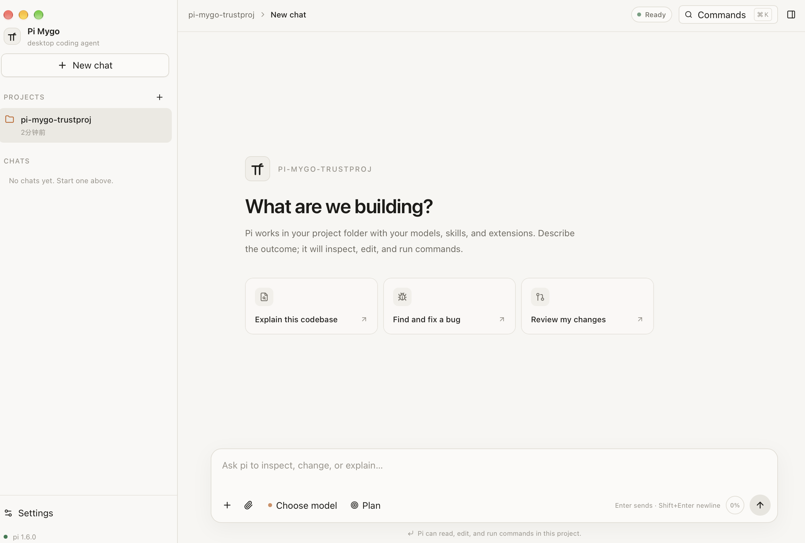

# Pi Mygo

A desktop coding agent built on [mygo](https://mygo.run) with
[pi](https://pi.dev) as the engine.



Pi Mygo is a small native shell around a rich web UI. It runs your installed
pi over RPC, so your existing models, credentials, sessions, skills, prompt
templates, packages, and extensions are the ones it uses. It does not bundle
pi, replace pi's data, or install a second agent runtime.

## Status (2026-11-23)

V1 is implemented and packaged for macOS arm64 validation. Core sessions,
streaming Markdown, extensions, approvals, plan mode, changes, MCP
configuration, worktrees, session search, and the desktop shell work; the
current artifact is a 27.0 MB app / 6.8 MB DMG. A wider release still needs
signing/notarization and a public update feed. English is the default; Chinese
is available in Settings. See
[`docs/03-progress.md`](docs/03-progress.md) for evidence and
[`docs/02-plan.md`](docs/02-plan.md) §8 for the roadmap.

## What works

- **Real pi sessions**: start, resume, rename, fork, clone, tree navigation,
  export HTML, delete to Trash, and multiple concurrent sessions.
- **Streaming chat**: Streamdown Markdown with GFM tables, Shiki code, KaTeX
  math, Mermaid diagrams, CJK line breaking, thinking blocks, images, tool cards,
  live shell output, diffs, compaction, retries, usage and cost.
- **Tool cards** for `bash`, `read`, `edit`, `write`, `grep`, `find`, `ls`,
  `todo`, `ask_user_question`, subagents, and any extension tool (generic card).
- **Composer**: `@file` search, pi slash commands, image paste/drop, text
  attachments, per-session drafts, model and thinking pickers.
- **Extensions**: existing pi extensions load unchanged; RPC dialogs appear in
  an inline dock; statuses and widgets are shown quietly; extension errors are
  visible. Shipped bridge adds tree navigation, plan mode, and optional smart
  approvals under `mygo-*` names only.
- **Project trust**: explicit dialog before project-local pi resources load;
  pi's own trust store is read, never written.
- **Approvals**: optional Smart / Ask all / Allow all policy, once/session
  grants, no auto-deny. When another guard such as `cc-safety-net` is detected,
  Pi Mygo's guard stays off unless enabled in Settings.
- **Plan mode**: read-only exploration and a plan, mutating tools blocked until
  you turn it off.
- **Changes and files**: Git branch/status, per-file unified diff, copy patch,
  per-file revert-to-HEAD with confirmation, reveal, file list and read-only
  preview.
- **MCP and worktrees**: manage user/project MCP entries (add, enable, remove;
  advanced fields stay in `mcp.json`), and list/create/open/remove Git
  worktrees.
- **Session search and plans**: full-text search across session branches from
  the command palette; Plan and Agents tabs read pi's todo state and subagent
  activity; `ask_user_question` renders as an inline card with the selected
  answer.
- **Notifications and language**: native completion notifications when a
  background run finishes, a Settings test button, and an English/Chinese UI
  switch.
- **Release plumbing**: GitHub CI for Go/frontend/cross-build/package,
  versioned release workflow, optional signing/notarization, and the mygo
  updater window. An update feed needs a public release host.
- **Providers**: in-app pty terminal running `pi auth login`; no credential
  storage or logging by the app.
- **Native shell**: hidden inset title bar, native menus, macOS appearance,
  quit guard for running sessions, single small binary.

More screenshots: [chat](docs/images/chat.png),
[approval](docs/images/approval.png), [plan mode](docs/images/plan.png),
[trust](docs/images/trust.png), [session tree](docs/images/session-tree.png),
[diff](docs/images/diff.png), [login](docs/images/login.png),
[Chinese shell](docs/images/zh-chat.png), [Chinese settings](docs/images/zh-settings.png).

## Requirements

- macOS (arm64 verified; the code is portable, Windows/Linux are untested).
- Go 1.27.3+ and Bun for building.
- pi **>= 1.6 < 2** installed and authenticated. Pi Mygo finds it in Settings,
  `PI_MYGO_PI`, `PATH`, common install locations, then your login shell.
  Use `pi auth login` (also available in the app) to connect a provider.

Pi is not bundled. The app is 27.0 MB and the initial DMG is 6.8 MB; pi itself
is a separate ~103 MB install.

## Run from source

```sh
bun install
bun run dev        # mygo dev: app window + Vite live reload
```

Useful environment variables during development:

| Variable | Purpose |
|---|---|
| `PI_MYGO_PI` | explicit pi executable |
| `PI_MYGO_OPEN` | open a workspace on launch |
| `PI_MYGO_OPEN_SESSION` | open a session file on launch |
| `PI_MYGO_DEV_PROMPT` | send a prompt after the deep-linked session opens |
| `PI_MYGO_GUARD_OVERRIDE` | force `off`, `smart`, `ask`, or `allow` for a test |

## Build

```sh
bun run build
open "build/darwin-arm64/Pi Mygo.app"
```

The build is ad-hoc signed and not notarized; macOS may require
System Settings → Privacy & Security → Open Anyway. The DMG is suitable for
local validation, not public distribution yet.

## Verify

```sh
./scripts/verify.sh
```

This runs Go build/vet/tests, frontend typecheck/tests, and the production
frontend build. A real-pi integration test is opt-in:

```sh
PI_MYGO_INTEGRATION=1 go test ./internal/agent -run TestStartAndInspectRealPi
```

## Architecture

```
mygo window (Go, system webview)
  ├─ typed IPC services: Desktop, Agent, Sessions, Files, Git, Auth
  ├─ one `pi --mode rpc` process per open session
  ├─ fast session JSONL reader for first paint
  ├─ bundled `mygo-bridge` pi extension (tree nav, plan, approvals)
  └─ React 19 frontend (Vite, Tailwind, Base UI/shadcn,
     Streamdown code/Mermaid plugins, TanStack Virtual)
```

Decisions and tradeoffs are in [`docs/01-decisions.md`](docs/01-decisions.md).
The research that led there, including competitor strengths and measured
prototypes, is in [`docs/00-research.md`](docs/00-research.md).

## Known limits

- Windows and Linux are not validated; macOS arm64 is the delivered target.
- The app requires an installed compatible pi. There is no bundled/auto-installer.
- RPC supports extension dialogs, statuses, and widgets, but not
  `ctx.ui.custom()` TUI components or custom editors/themes. Some extensions
  degrade or offer text fallbacks; Pi Mygo does not fake them.
- Auto-update is wired through mygo's updater, but the repository currently has
  no public release feed or update signing key. Signed/notarized public builds
  remain follow-up work.
- Extension dialogs and generic tool cards remain the fallback for custom
  extension UIs; native menu labels stay English in Chinese mode.
- Smart approvals are heuristics, not a sandbox. Use the OS, a container, or pi's
  own isolation when you need a real boundary.

## Documentation

1. [`docs/00-research.md`](docs/00-research.md)
2. [`docs/01-decisions.md`](docs/01-decisions.md)
3. [`docs/02-plan.md`](docs/02-plan.md)
4. [`docs/03-progress.md`](docs/03-progress.md)
5. [`docs/04-pitfalls.md`](docs/04-pitfalls.md)
6. [`docs/05-qa.md`](docs/05-qa.md)
7. [`docs/06-ux.md`](docs/06-ux.md)
8. [`docs/07-grilling.md`](docs/07-grilling.md)
9. [`docs/08-delivery.md`](docs/08-delivery.md)

## License

MIT
