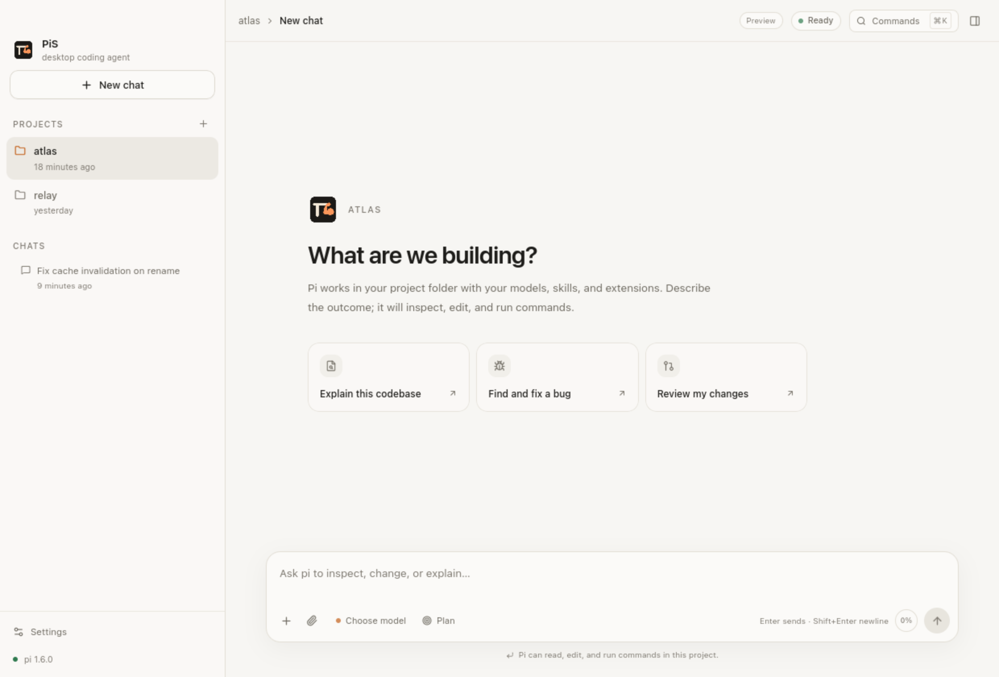

<p align="center"></p>

# PiS

A desktop coding agent built on [mygo](https://mygo.run) with
[pi](https://pi.dev) as the engine. The S stands for strong.



PiS is a small native shell around a rich web UI. It runs your installed
pi over RPC, so your existing models, credentials, sessions, skills, prompt
templates, packages, and extensions are the ones it uses. It does not bundle
pi, replace pi's data, or install a second agent runtime.

## Status (2026-11-24)

V1 is implemented and packaged for macOS arm64 validation; the release workflow
builds macOS, Windows, and Linux artifacts for both amd64 and arm64. Core sessions,
streaming Markdown, extensions, approvals, plan mode, changes, MCP
configuration, worktrees, session search, and the desktop shell work.
Current public release: **[0.0.2](https://github.com/ModyQyW/pis/releases/tag/v0.0.2)**
(27.0 MB app / 6.8 MB DMG). The release and update feed are public; macOS is
ad-hoc signed, so Gatekeeper requires a one-time approval. English is the
default; Chinese is available in Settings. See
[`dev-docs/03-progress.md`](dev-docs/03-progress.md) for evidence and
[`dev-docs/02-plan.md`](dev-docs/02-plan.md) §8 for the roadmap.

## What works

- **Real pi sessions**: start, resume, rename, fork, clone, tree navigation,
  export HTML, delete to Trash, and multiple concurrent sessions.
- **Streaming chat**: Streamdown Markdown with GFM tables, Shiki code, KaTeX
  math, Mermaid diagrams, CJK line breaking, thinking blocks, images, tool cards,
  live shell output, diffs, compaction, retries, usage and cost.
- **Tool cards** for `bash`, `read`, `edit`, `write`, `grep`, `find`, `ls`,
  `todo`, `ask_user_question`, subagents, and any extension tool (generic card).
- **Composer**: `@file` search, pi slash commands, image paste/drop, text
  attachments, per-session drafts, model and thinking pickers.
- **Extensions**: existing pi extensions load unchanged; RPC dialogs appear in
  an inline dock; statuses and widgets are shown quietly; extension errors are
  visible. Shipped bridge adds tree navigation, plan mode, and optional smart
  approvals under `pis-*` names only.
- **Project trust**: explicit dialog before project-local pi resources load;
  pi's own trust store is read, never written.
- **Approvals**: optional Smart / Ask all / Allow all policy, once/session
  grants, no auto-deny. When another guard such as `cc-safety-net` is detected,
  PiS's guard stays off unless enabled in Settings.
- **Plan mode**: read-only exploration and a plan, mutating tools blocked until
  you turn it off.
- **Changes and files**: Git branch/status, per-file unified diff, copy patch,
  per-file revert-to-HEAD with confirmation, reveal, file list and read-only
  preview.
- **MCP and worktrees**: manage user/project MCP entries (add, enable, remove;
  advanced fields stay in `mcp.json`), and list/create/open/remove Git
  worktrees.
- **Session search and plans**: full-text search across session branches from
  the command palette; Plan and Agents tabs read pi's todo state and subagent
  activity; `ask_user_question` renders as an inline card with the selected
  answer.
- **Notifications and language**: native completion notifications when a
  background run finishes, a Settings test button, and an English/Chinese UI
  switch.
- **Release plumbing**: GitHub CI for Go/frontend/cross-build/package,
  versioned release workflow, optional signing/notarization, and the mygo
  updater window. Updates use the public GitHub Releases feed.
- **Providers**: in-app pty terminal running `pi auth login`; no credential
  storage or logging by the app.
- **Native shell**: hidden inset title bar, native menus, macOS appearance,
  quit guard for running sessions, single small binary.

More screenshots: [chat](dev-docs/images/chat.png),
[approval](dev-docs/images/approval.png), [plan mode](dev-docs/images/plan.png),
[trust](dev-docs/images/trust.png), [session tree](dev-docs/images/session-tree.png),
[diff](dev-docs/images/diff.png), [login](dev-docs/images/login.png),
[Chinese shell](dev-docs/images/zh-chat.png), [Chinese settings](dev-docs/images/zh-settings.png).

## Requirements

- macOS (arm64 verified; Windows/Linux builds are produced but runtime-untested).
- Go 1.27.3+ and Bun for building.
- pi **>= 1.6 < 2** installed and authenticated. PiS finds it in Settings,
  `PIS_PI`, `PATH`, common install locations, then your login shell.
  Use `pi auth login` (also available in the app) to connect a provider.

Pi is not bundled. The app is 27.0 MB and the initial DMG is 6.8 MB; pi itself
is a separate ~103 MB install.

## Run from source

```sh
bun install
bun run dev        # mygo dev: app window + Vite live reload
```

Useful environment variables during development:

| Variable | Purpose |
|---|---|
| `PIS_PI` | explicit pi executable |
| `PIS_OPEN` | open a workspace on launch |
| `PIS_OPEN_SESSION` | open a session file on launch |
| `PIS_DEV_PROMPT` | send a prompt after the deep-linked session opens |
| `PIS_GUARD_OVERRIDE` | force `off`, `smart`, `ask`, or `allow` for a test |

## Build

```sh
bun run build
open "build/darwin-arm64/PiS.app"
```

Release builds are ad-hoc signed and not notarized; macOS may require
System Settings → Privacy & Security → Open Anyway. Published artifacts are on
[GitHub Releases](https://github.com/ModyQyW/pis/releases).

## Verify

Before committing, format and run the full gate:

```sh
bun run format
./scripts/verify.sh
```

`bun run format` runs `go fmt ./...` and Vite+'s `vp check --fix`.
`./scripts/verify.sh` runs Go formatting/build/vet/tests, Vite+ format/lint/
typecheck, bridge and frontend tests, the frontend build, and the user-docs
build. `bun install` installs a Vite+ pre-commit hook that runs the same gate.
Vite+ is a project dependency; no global `vp` install is required. A real-pi integration
test is opt-in:

```sh
PIS_INTEGRATION=1 go test ./internal/agent -run TestStartAndInspectRealPi
```

## Architecture

```
mygo window (Go, system webview)
  ├─ typed IPC services: Desktop, Agent, Sessions, Files, Git, Auth
  ├─ one `pi --mode rpc` process per open session
  ├─ fast session JSONL reader for first paint
  ├─ bundled `pis-bridge` pi extension (tree nav, plan, approvals)
  └─ React 19 frontend (Vite, Tailwind, Base UI/shadcn,
     Streamdown code/Mermaid plugins, TanStack Virtual)
```

Decisions and tradeoffs are in [`dev-docs/01-decisions.md`](dev-docs/01-decisions.md).
The research that led there, including competitor strengths and measured
prototypes, is in [`dev-docs/00-research.md`](dev-docs/00-research.md).

## Known limits

- macOS arm64 is runtime-validated; Windows/Linux artifacts build but have not had runtime QA.
- The app requires an installed compatible pi. There is no bundled/auto-installer.
- RPC supports extension dialogs, statuses, and widgets, but not
  `ctx.ui.custom()` TUI components or custom editors/themes. Some extensions
  degrade or offer text fallbacks; PiS does not fake them.
- Auto-update uses GitHub Releases and an Ed25519 update key; the signed
  0.0.1 → 0.0.2 update was verified, and 0.0.2 ships deltas for every target. macOS builds are ad-hoc signed, not
  notarized; Gatekeeper requires a one-time Open Anyway approval.
- Extension dialogs and generic tool cards remain the fallback for custom
  extension UIs; native menu labels stay English in Chinese mode.
- Smart approvals are heuristics, not a sandbox. Use the OS, a container, or pi's
  own isolation when you need a real boundary.

## Documentation

- **User guide:** [`user-docs/`](user-docs/), built with
  [Rspress](https://rspress.rs/). It covers installation, daily use, approvals,
  extensions, architecture, development, release, configuration, and
  troubleshooting.
- **Development record:** [`dev-docs/`](dev-docs/), from research and decisions
  through plan, progress, pitfalls, QA, UX, and delivery evidence.

The Rspress source lives in `user-docs/`; the build output is
`user-docs-build/` and is not committed.

```sh
bun run docs:dev
bun run docs:build
bun run docs:preview
```

Development record:

1. [`dev-docs/00-research.md`](dev-docs/00-research.md)
2. [`dev-docs/01-decisions.md`](dev-docs/01-decisions.md)
3. [`dev-docs/02-plan.md`](dev-docs/02-plan.md)
4. [`dev-docs/03-progress.md`](dev-docs/03-progress.md)
5. [`dev-docs/04-pitfalls.md`](dev-docs/04-pitfalls.md)
6. [`dev-docs/05-qa.md`](dev-docs/05-qa.md)
7. [`dev-docs/06-ux.md`](dev-docs/06-ux.md)
8. [`dev-docs/07-grilling.md`](dev-docs/07-grilling.md)
9. [`dev-docs/08-delivery.md`](dev-docs/08-delivery.md)

## License

MIT. The icon includes a silhouette adapted from Noto Emoji; see
[`NOTICE.md`](NOTICE.md) and [`LICENSES/Apache-2.0.txt`](LICENSES/Apache-2.0.txt).
