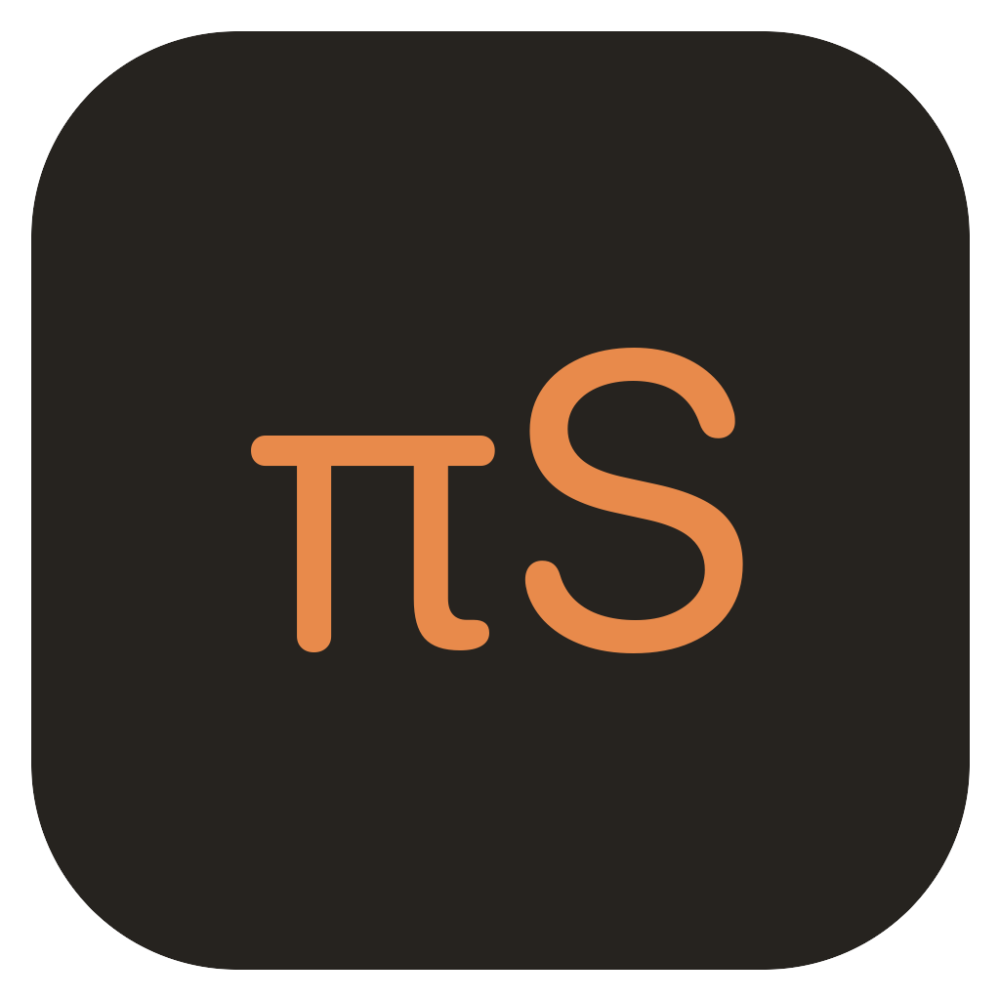
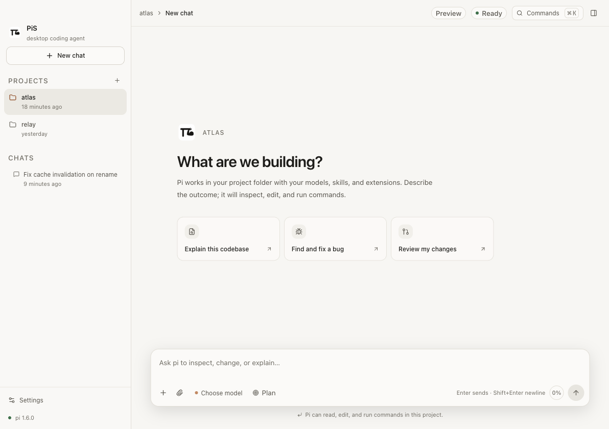

[English](README.md) | 简体中文

<p align="center"></p>

默认图标使用白色背景。黑色背景版本见
[`resources/icon-dark.png`](resources/icon-dark.png)。

# PiS

PiS 是基于 [mygo](https://mygo.run)、以 [pi](https://pi.dev) 为引擎的桌面 Coding Agent。S 表示 strong。



PiS 是围绕 pi 的小型原生外壳，并提供完整的 Web UI。它通过 RPC 运行你安装的 pi，因此模型、凭据、会话、技能、提示模板、包和扩展都来自你已有的 pi。PiS 不捆绑 pi，不保留第二份配置，也不安装第二套 agent runtime。只有你在应用中保存更改后，PiS 才写入 pi 的 `settings.json`、`models.json` 和 `mcp.json`。

## 状态（2026-11-27）

V1 已完成，并针对 macOS arm64 打包验证。Release workflow 为 macOS、Windows 和 Linux 构建 amd64 与 arm64 产物。核心会话、流式 Markdown、扩展、审批、计划模式、更改、MCP 配置、工作树、会话搜索和桌面外壳均可用。

当前公开版本是 **[0.0.11](https://github.com/ModyQyW/pis/releases/tag/v0.0.11)**（arm64 DMG 7.3 MB）。更新 feed 指向 `0.0.11`。Release 和更新 feed 公开。macOS 使用 ad-hoc 签名，Gatekeeper 需要一次手动放行。默认语言是英文，设置中可切换中文。

验证证据见 [`docs-dev/testing.zh.md`](docs-dev/testing.zh.md)。项目历史见 [`docs-dev/history.zh.md`](docs-dev/history.zh.md)。

## 可用功能

- **真实 pi 会话**：新建、恢复、重命名、分叉、克隆、会话树导航、导出 HTML、删除到废纸篓，以及多个并发会话。
- **流式聊天**：Streamdown Markdown、GFM 表格、Shiki 代码、KaTeX 数学、Mermaid 图、CJK 换行、思考块（近似时长）、图片、工具卡片、实时 shell 输出、diff、压缩、重试、用量和费用。
- **工具卡片**：`bash`、`read`、`edit`、`write`、`grep`、`find`、`ls`、`todo`、`ask_user_question`、子代理，以及任意扩展工具（通用卡片）。长输出默认限制高度，并提供「展开全部」和「收起」。
- **输入框**：`@file` 搜索、pi 斜杠命令、图片粘贴和拖放、文本附件、按会话保存草稿、模型和思考级别选择器，以及设置中的代码字号、界面大小和发送键。
- **扩展**：现有 pi 扩展原样加载。RPC 对话框显示在内联坞中，状态和 widget 安静显示，扩展错误可见。内置 bridge 只以 `pis-*` 名称提供会话树、计划模式和可选 Smart 审批。
- **项目信任**：加载项目级 pi 资源前显示明确对话框。pi 自己的信任存储只读，不写入。
- **审批**：可选 Smart / Ask all / Allow all 策略，支持一次和会话内授权，不自动拒绝。检测到 `cc-safety-net` 等 guard 时，PiS 的内置 guard 默认关闭，除非在设置中启用。
- **计划模式**：只读探索和计划。常见修改类工具和 shell 命令会被阻止。它是工作流保护，不是沙箱。
- **更改与文件**：Git 分支和状态、逐文件统一 diff、复制 patch、逐文件还原到 HEAD 并确认、显示文件、文件列表和只读预览。
- **pi 配置**：查看 pi 加载的默认值、自定义提供商和模型、技能、扩展、包和 MCP 服务器，并在配置变化时确认。可以修改启动默认值、兼容提供商及其模型、技能和扩展路径、包来源。设置提供分区列表和搜索；提供商和模型字段可搜索，模型弹窗按提供商过滤。只有你保存时，写入才进入 pi 自己的文件；已保存的 API 密钥不会读回。
- **MCP 与工作树**：管理用户级和项目级 MCP 条目（添加、启用、删除；高级字段留在 `mcp.json`），以及列出、创建、打开和移除 Git 工作树。移除有未提交文件的工作树会被拒绝；强制移除需要第二次确认。
- **会话搜索和计划**：命令面板全文搜索会话分支；Plan 和 Agents 标签读取 pi 的 todo 状态和子代理活动；`ask_user_question` 显示为内联卡片，并标出已选答案。
- **通知和语言**：后台运行结束时发送原生通知，设置中有测试按钮，界面支持英文和中文。
- **发布流程**：GitHub CI 覆盖 Go、前端、交叉构建和打包；版本化 Release workflow；可选签名和 notarization；mygo updater 窗口；更新来自公开 GitHub Releases。
- **提供商**：应用内 pty 终端运行 `pi auth login`。应用不保存或记录凭据。自定义提供商密钥通过「pi 配置」对话框写入 pi 的 `models.json`，不会返回界面。
- **原生外壳**：隐藏式 inset 标题栏、原生菜单、macOS 外观、运行中会话退出保护、单个小二进制。

更多截图：[聊天](docs-user/public/images/chat.png)、
[审批](docs-user/public/images/approval.png)、
[计划模式](docs-user/public/images/plan.png)、
[信任](docs-user/public/images/trust.png)、
[会话树](docs-user/public/images/session-tree.png)、
[diff](docs-user/public/images/diff.png)、
[登录](docs-user/public/images/login.png)、
[MCP](docs-user/public/images/mcp.png)、
[工作树](docs-user/public/images/worktrees.png)、
[中文聊天](docs-user/public/images/zh-chat.png)、
[中文设置](docs-user/public/images/zh-settings.png)。

## 要求

- macOS（arm64 已验证；Windows/Linux 产物可构建，但运行时未完整测试）。
- 构建需要 Go 1.27.3+ 和 Bun。
- 安装并登录 **pi >= 1.6 < 2**。PiS 会依次检查设置、`PIS_PI`、`PATH`、常见安装位置和登录 shell。
  使用 `pi auth login`（也可以在应用内运行）连接提供商。

PiS 不捆绑 pi。arm64 DMG 为 7.2 MB；pi 是单独的安装。

## 从源码运行

```sh
bun install
bun run dev        # mygo dev：应用窗口 + Vite 热更新
```

开发时可用的环境变量：

| 变量                 | 作用                                        |
| -------------------- | ------------------------------------------- |
| `PIS_PI`             | 指定 pi 可执行文件                          |
| `PIS_OPEN`           | 启动时打开项目                              |
| `PIS_OPEN_SESSION`   | 启动时打开会话文件                          |
| `PIS_DEV_PROMPT`     | 深链接会话打开后发送一条 prompt             |
| `PIS_GUARD_OVERRIDE` | 为测试强制 `off`、`smart`、`ask` 或 `allow` |

## 构建

```sh
bun run build
open "build/darwin-arm64/PiS.app"
```

Release 构建使用 ad-hoc 签名，未 notarize。macOS 可能需要“系统设置 → 隐私与安全性 → 仍要打开”。发布产物见 [GitHub Releases](https://github.com/ModyQyW/pis/releases)。

## 验证

提交前先格式化，再运行完整门禁：

```sh
bun run format
./scripts/check.sh
```

`bun run format` 只做格式化：对模块包运行 `go fmt`，再运行 Vite+ 的 `vp fmt`。
`./scripts/check.sh` 运行 Go 格式、构建、vet、测试，Vite+ 格式、lint、类型检查，bridge 和前端测试，前端构建，以及中英文文档构建。`bun run check` 使用同一个门禁。`bun install` 会安装 Vite+ pre-commit hook，提交时运行 `./scripts/check.sh`。Vite+ 是项目依赖，不需要全局 `vp`。真实 pi 集成测试是可选：

```sh
PIS_INTEGRATION=1 go test ./internal/agent -run TestStartAndInspectRealPi
```

## 架构

```text
mygo 窗口（Go，系统 WebView）
  ├─ typed IPC 服务：Desktop、Agent、Sessions、Files、Git、Auth
  ├─ 每个打开会话一个 `pi --mode rpc` 进程
  ├─ 快速 session JSONL 读取，用于首屏
  ├─ 内置 `pis-bridge` pi 扩展（会话树、计划、审批）
  └─ React 19 前端（Vite、Tailwind、Base UI/shadcn、
     Streamdown code/Mermaid 插件、TanStack Virtual）
```

决策和取舍见 [`docs-dev/decisions.zh.md`](docs-dev/decisions.zh.md)。当前架构见 [`docs-dev/architecture.zh.md`](docs-dev/architecture.zh.md)。研究、竞品分析和原型测量见 [`docs-dev/research.zh.md`](docs-dev/research.zh.md)。

## 已知限制

- macOS arm64 已验证运行时；Windows/Linux 产物可构建，但运行时 QA 未完成。
- 应用需要已安装的兼容 pi。没有捆绑版或自动安装器。
- RPC 支持扩展对话框、状态和 widget，但不支持 `ctx.ui.custom()` TUI 组件或自定义编辑器/主题。部分扩展会降级或提供文本回退；PiS 不伪造。
- 自动更新使用 GitHub Releases 和 Ed25519 密钥。`0.0.1 → 0.0.2` 签名更新已验证。公开的 `0.0.4` manifest 和 `0.0.2 → 0.0.4` delta 已验证。现在不再发布 delta 文件，更新下载完整 archive。已安装应用的更新流程未运行。macOS 构建是 ad-hoc 签名，未 notarize；Gatekeeper 需要一次“仍要打开”。
- 扩展对话框和通用工具卡片仍是自定义扩展 UI 的回退；中文模式下原生菜单保持英文。
- Markdown 中的远程图片会自动加载。模型输出或导入的会话可能发起网络请求。链接仍然只有点击后才会打开。见 [`docs-dev/decisions.zh.md`](docs-dev/decisions.zh.md) 的 ADR-019。
- Smart 审批和计划模式是启发式规则，不是沙箱。需要真实边界时使用 OS、容器或 pi 自己的隔离。

## 文档

- **用户指南**：[`docs-user/en/`](docs-user/en/) 和 [`docs-user/zh/`](docs-user/zh/)，用 [Rspress](https://rspress.rs/) 构建，发布在 <https://pis.modyqyw.top>。内容覆盖安装、界面、项目、会话、输入框、更改、审批、模型、MCP、工作树、扩展、设置和故障排查。
- **开发文档**：[`docs-dev/`](docs-dev/)，从 [`docs-dev/README.zh.md`](docs-dev/README.zh.md) 开始。内容覆盖调研、架构、功能实现、UX、本地开发、测试、发布、文档站、决策、陷阱和项目历史。主要指南有英文和中文版本。
- **更新日志**：[`CHANGELOG.md`](CHANGELOG.md) 和 [`CHANGELOG.zh.md`](CHANGELOG.zh.md)。

Rspress 源文件在 `docs-user/`。构建输出是 `docs-user-build/`，不进入 Git。

```sh
bun run docs:dev
bun run docs:build
bun run docs:preview
```

Cloudflare Pages 部署步骤见 [`docs-dev/docs-site.zh.md`](docs-dev/docs-site.zh.md)。

## 许可证

MIT。图标包含改编自 Noto Emoji 的剪影；见
[`NOTICE.md`](NOTICE.md) 和 [`LICENSES/Apache-2.0.txt`](LICENSES/Apache-2.0.txt)。
