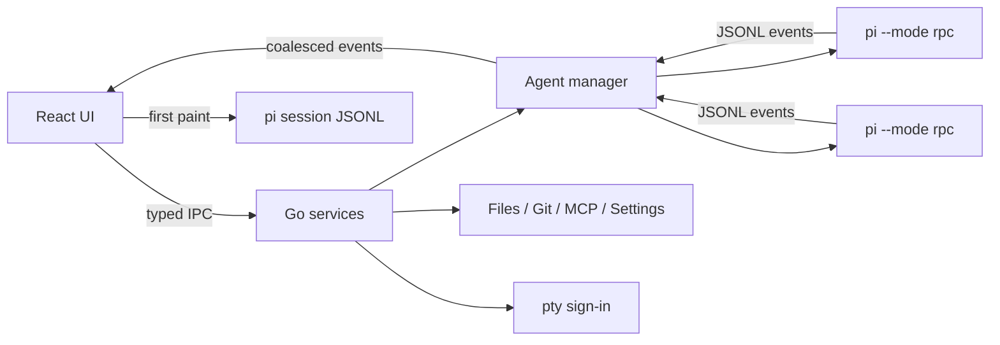
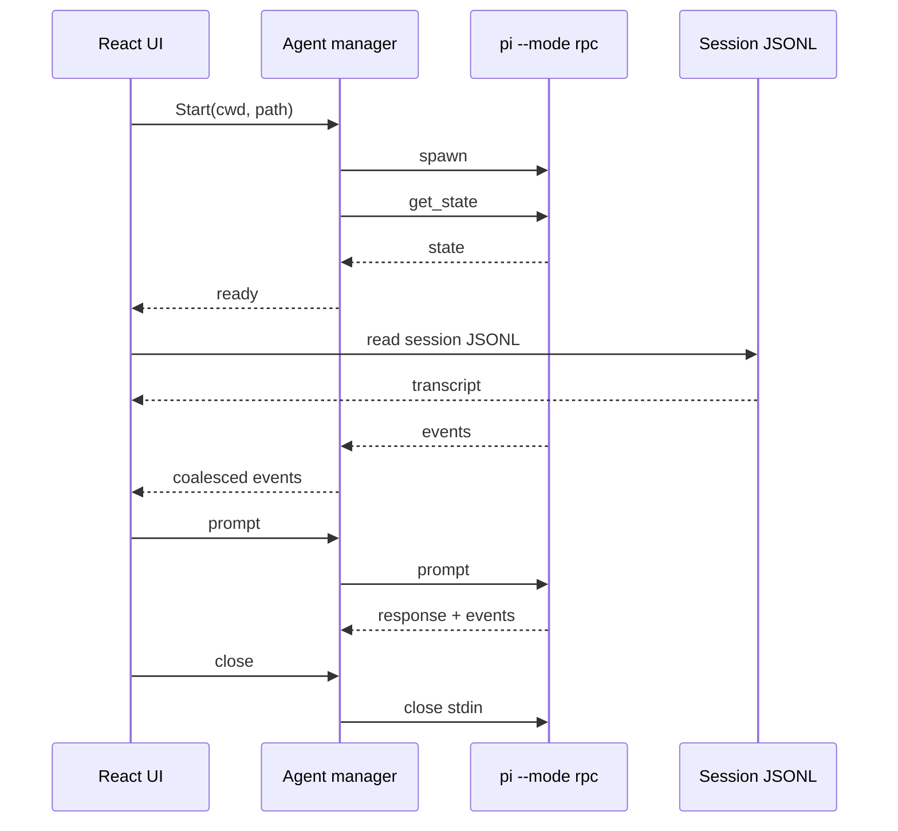

# Architecture and data flow

[English](architecture.md) | [简体中文](architecture.zh.md)

PiS is a desktop shell for pi. It does not implement model calls, store credentials, or keep a second session store.

## Components

| Directory | Responsibility |
|---|---|
| `main.go` | Window, native menus, IPC bindings, quit guard |
| `internal/agent` | pi processes, RPC commands, events, delta coalescing |
| `internal/app` | Projects, settings, session service, menu events |
| `internal/auth` | pty terminal for `pi auth login` |
| `internal/bridge` | Bundled pi extension for session tree, plan mode, and approvals |
| `internal/sessions` | Session JSONL reads, summaries, search |
| `internal/files` | File list, search, read-only preview |
| `internal/gitx` | Git status, diff, revert, worktrees |
| `internal/mcp` | `mcp.json` reads and atomic writes |
| `internal/trust` | Project trust resources and pi trust record reads |
| `internal/settings` | App settings and schema migration |
| `internal/piinfo` | pi discovery and version checks |
| `internal/shellpath` | Login shell `PATH` |
| `frontend/src` | React UI, state, IPC wrappers |

## Window and IPC

mygo provides the system WebView, window, menus, notifications, and IPC. Go services bind with `mygo.BindAs`:

| Name | Service |
|---|---|
| `Desktop` | Bootstrap, projects, settings, diagnostics, notifications |
| `Agent` | Sessions, models, events, extension UI |
| `Sessions` | Session file list, read, delete, export |
| `Files` | File search and preview |
| `Git` | Status, diff, revert, worktrees |
| `MCP` | MCP configuration |
| `Auth` | Sign-in pty |

`frontend/src/mygo.ts` is generated by `bun run generate`. It exports the TypeScript signature of every bound method. Do not edit this file by hand.

Every exported Go method appears on the IPC surface. Before you export a method, confirm that the page needs to call it. A compromised renderer can call every exported method.

## Process model

Each open session has one `pi --mode rpc` child process.

Start arguments:

- New session: `--session-id <id>`, optional `--name`, `--approve`, `-e <bridge>`.
- Resume: `--session <path>`.
- Environment: `PIS=1`, `PIS_SESSION_ID`, `PIS_GUARD`, `PIS_WORKSPACE`.

The agent manager maps a session id to its process. When a session closes, Go closes stdin, waits 3 seconds, then kills the process.

Sessions do not block each other. Each process has its own context and tool state.

## RPC frames

pi writes JSONL to stdout, one JSON object per line. Types:

- `response`: a command response, matched by `id`.
- `extension_ui_request`: an extension UI request.
- Events: `agent_start`, `message_update`, `tool_execution_start`, `agent_settled`. See the pi documentation for the full list.

Go behavior:

- `dispatch` sends each response to the waiting call by `id`.
- UI requests go to the frontend and do not enter event reduction.
- Other records go to the manager and the coalescer.
- A single line is limited to 64 MB. An overlong line is dropped and produces an error event. The reader discards bytes while it reads; it does not buffer the whole line first.
- stderr keeps the last 200 lines for crash messages. It is not a logging system.

Calls have timeouts. A timeout or a process exit returns an error. On process exit, every waiting call receives `pi exited`.

## Delta coalescing

pi sends text output token by token. Forwarding every token causes many React updates.

The coalescer merges every 16 ms:

- `text_delta` and `thinking_delta` merge by session, type, and content index.
- A non-delta event flushes pending text first, then forwards in order.
- Session end, tool call start, and tool call end force a flush.

The frontend receives `text` and `thinking` events with deltas only. The full message arrives in `message_end`.

## Frontend state

`frontend/src/store/chat.ts` holds state for each session:

- Session entries, live assistant blocks, tool run records.
- Model, thinking level, auto-compaction.
- Drafts, attachments, dialogs, statuses, and widgets.
- Event queue and orphan events.

Event flow:

1. Find the session by `sessionId`.
2. If the session is missing, put the event in `orphan` and replay it after the session id is known.
3. Record closed session ids in `closedSessions`. Drop late events.
4. Text deltas update the live block.
5. Message end appends an entry.
6. Tool events update tool cards.

A session can receive events before its id is ready. The `orphan` queue covers this gap. If the user closes the session before start completes, the late start result calls `closeSession` at once. The pi process does not leak.

`frontend/src/lib/transcript.ts` turns entries, live blocks, and tool runs into display items. Tool results pair by id. Extension `custom_message` entries render from top-level `content`.

The transcript uses TanStack Virtual. It renders only the visible area and overscan.

## First paint

PiS does not wait for pi to rebuild context. When a session opens:

1. Read the pi session JSONL directly.
2. Build the active branch.
3. Show messages, tool results, compaction summaries, and branch summaries.
4. Start the pi process in parallel.

Read limits:

- One display read: 128 MB.
- File search: 2 MB per session.
- Summary scan: 4 MB per file.
- Summary cache: keyed by path, cwd, mtime, and size.
- Search reads do not change session files.

pi remains the source of truth for model context. The PiS read is for display only.

## Data ownership

pi owns:

- Session files.
- Sign-in state.
- Model configuration.
- Extensions, skills, and prompt templates.
- The pi trust record.

PiS owns:

- `settings.json`.
- `window-state.json`.
- The bundled bridge extension.
- Local drafts and the last-session key.

PiS writes `mcp.json` only after a user action. When you delete a session, PiS moves the file to the system Trash.

PiS does not write pi `trust.json`, `auth.json`, model configuration, or session content.

## Trust

`internal/trust/Inspect` computes project trust state.

Resources:

- `.pi/settings.json`, `mcp.json`, `extensions`, `skills`, `prompts`, and `themes` in the project root.
- `.pi/SYSTEM.md` and `.pi/APPEND_SYSTEM.md`.
- `SYSTEM.md` and `APPEND_SYSTEM.md` in the project root.
- `.agents/skills` in the project root and every ancestor.
- The user's own `~/.agents/skills` is excluded.

Decision order:

1. The decision saved by PiS.
2. The nearest ancestor record in pi `trust.json`.
3. Undecided: show the dialog.

After the user trusts the project, the start arguments include `--approve`. pi treats it as a one-run approval. PiS does not write the pi trust file.

`--approve` grants full trust. The resource list must cover every resource pi loads. A missing resource can load without a dialog. When pi adds a trust resource, update `internal/trust` and its tests.

## Approvals and plan mode

`internal/bridge/bridge.ts` is a pi extension loaded with `-e`.

Approvals:

- The `tool_call` event checks the tool name and arguments.
- Smart checks destructive shell, sensitive files, outside-workspace paths, and change tools.
- Each approval creates a grant key. Session grants stay in memory.
- Calls are refused when no UI is available, so unattended runs do not execute.

Plan mode:

- Limits the active tools to a read-only set.
- Checks change tools and shell commands in `tool_call`.
- Injects plan instructions through `before_agent_start`.
- Stores state in a `pis-plan` custom entry.

Plan mode is a rule guard. Interpreter commands and unknown extension tools can bypass the checks. ADR-009 and ADR-010 record this boundary.

## Security boundaries

- Project trust controls whether project resources load.
- Approval controls one tool call.
- Plan mode controls whether the current session can change files.
- System permissions, containers, and VMs are the isolation boundary.

Other facts:

- Only pi stores credentials.
- Diagnostics contains no prompts or session content.
- File preview and untracked diff resolve symlinks and check the workspace boundary.
- Markdown remote images load directly. ADR-019 records this tradeoff.
- The renderer can call every exported IPC method. Check least privilege when you add one.

## Performance constraints

ADR-013 makes performance an acceptance condition.

Main techniques:

- 16 ms delta coalescing.
- Virtualized transcript.
- Lazy Markdown, code grammars, Mermaid, and KaTeX.
- First paint from JSONL without a full context rebuild.
- Session summary cache.
- Bounded search reads.
- On-demand tool output rendering.

Before you change these paths, read the verification record and budgets in [Testing](testing.md).

## Related

- [Local development](development.md)
- [Feature implementation](features.md)
- [Testing](testing.md)
- [Decisions](decisions.md)
- [Pitfalls](pitfalls.md)
