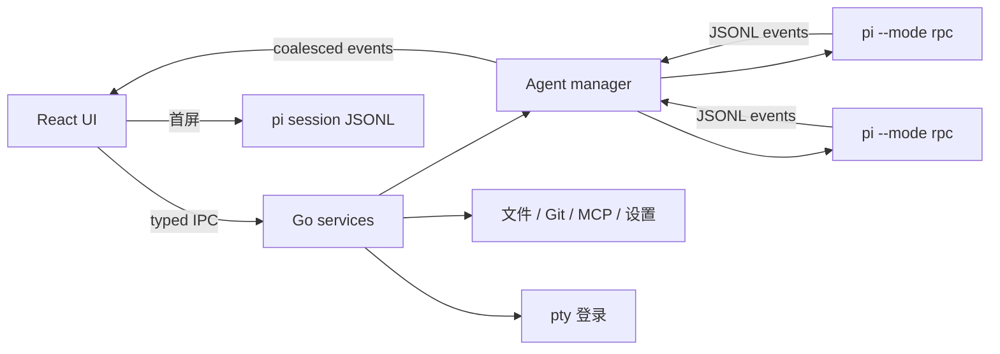
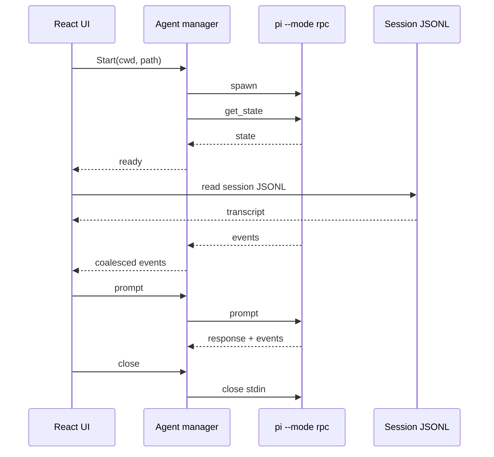

# 架构与数据流

[English](architecture.md) | 简体中文

PiS 是 pi 的桌面外壳。它不实现模型调用，不保存凭据，不维护第二套会话。

## 组件

| 目录 | 职责 |
|---|---|
| `main.go` | 窗口、原生菜单、IPC 绑定、退出保护 |
| `internal/agent` | pi 进程、RPC 命令、事件、增量合并 |
| `internal/app` | 项目、设置、会话服务、菜单事件 |
| `internal/auth` | `pi auth login` 的 pty 终端 |
| `internal/bridge` | 内置 pi 扩展，补齐会话树、计划模式和审批 |
| `internal/sessions` | 会话 JSONL 读取、摘要、搜索 |
| `internal/files` | 文件列表、搜索、只读预览 |
| `internal/gitx` | Git 状态、diff、还原、工作树 |
| `internal/mcp` | `mcp.json` 读取和原子写入 |
| `internal/piconf` | pi 设置、提供商、技能、扩展和包的读取与原子写入 |
| `internal/trust` | 项目信任资源和 pi 信任记录读取 |
| `internal/settings` | 应用设置和 schema 迁移 |
| `internal/piinfo` | pi 路径发现和版本检查 |
| `internal/shellpath` | 登录 shell 的 `PATH` |
| `frontend/src` | React UI、状态、IPC 包装 |

## 窗口和 IPC

mygo 提供系统 WebView、窗口、菜单、通知和 IPC。Go 服务用 `mygo.BindAs` 绑定：

| 名称 | 服务 |
|---|---|
| `Desktop` | 启动状态、项目、设置、诊断、通知 |
| `Agent` | 会话、模型、事件、扩展 UI |
| `Sessions` | 会话文件列表、读取、删除、导出 |
| `Files` | 文件搜索和预览 |
| `Git` | 状态、diff、还原、工作树 |
| `MCP` | MCP 配置 |
| `Auth` | 登录 pty |

`frontend/src/mygo.ts` 由 `bun run generate` 生成。它导出每个绑定方法的 TypeScript 签名。不得手改这个文件。

每个导出的 Go 方法都会出现在 IPC 表面。新增导出方法前确认它需要给页面调用。渲染进程被攻破时，页面可以调用所有导出方法。

## 进程模型

每个打开的会话对应一个 `pi --mode rpc` 子进程。

启动参数：

- 新会话：`--session-id <id>`，可选 `--name`、`--approve`、`-e <bridge>`。
- 恢复会话：`--session <path>`。
- 环境变量：`PIS=1`、`PIS_SESSION_ID`、`PIS_GUARD`、`PIS_WORKSPACE`。

`Agent manager` 用 map 保存会话 id 到进程。会话关闭时，Go 侧关闭 stdin，等待 3 秒，再杀进程。

多个会话互不阻塞。每个进程有自己的上下文和工具状态。

## RPC 帧

pi 通过 stdout 输出 JSONL，每行一个 JSON 对象。类型：

- `response`：命令响应，按 `id` 匹配。
- `extension_ui_request`：扩展 UI 请求。
- 事件：`agent_start`、`message_update`、`tool_execution_start`、`agent_settled`。其他事件见 pi 文档。

Go 侧行为：

- `dispatch` 按 `id` 把响应交给等待的调用。
- UI 请求单独发给前端，不进入事件归约。
- 其他记录交给 manager 和 coalescer。
- 单行上限为 64 MB。超长行被丢弃，并产生一条错误事件。读取器边读边丢，不先缓存整行。
- stderr 保留最后 200 行，用于崩溃信息。它不是日志系统。

命令调用有超时。超时或进程退出时，调用返回错误。进程退出时，所有等待中的调用收到 `pi exited`。

## 增量合并

pi 的文本输出按 token 发送。直接转发会造成大量 React 更新。

`coalescer` 每 16 ms 合并一次：

- `text_delta` 和 `thinking_delta` 按会话、类型和内容索引合并。
- 非增量事件先 flush 待处理文本，再按顺序转发。
- 会话结束、工具调用开始和结束时强制 flush。

前端收到的 `text` 和 `thinking` 事件只包含增量。完整消息以 `message_end` 到达。

## 前端状态

`frontend/src/store/chat.ts` 保存每个会话的状态：

- 会话条目、实时助手块、工具运行记录。
- 模型、思考级别、自动压缩。
- 草稿、附件、对话框、状态和 widget。
- 事件队列和孤儿事件。

事件处理：

1. 按 `sessionId` 找到会话。
2. 找不到时放入 `orphan`，等待会话 id 就绪后重放。
3. 关闭的会话 id 记入 `closedSessions`。迟到事件直接丢弃。
4. 文本增量更新实时块。
5. 消息结束追加到条目。
6. 工具事件更新工具卡片。

会话启动可能在 id 就绪前收到事件。`orphan` 队列解决这个时间差。会话在启动完成前被关闭时，迟到的启动结果会立刻 `closeSession`，pi 进程不会残留。

`frontend/src/lib/transcript.ts` 把条目、实时块和工具运行记录转换成显示项。工具结果按 id 配对。扩展 `custom_message` 按顶层 `content` 渲染。

会话列表使用 TanStack Virtual。只渲染可见区域和 overscan。

## 首屏

PiS 不等待 pi 重建上下文。打开会话时：

1. 直接读取 pi 的 session JSONL。
2. 构建活动分支。
3. 显示消息、工具结果、压缩摘要和分支摘要。
4. 同时启动 pi 进程。

读取上限：

- 单次显示读取：128 MB。
- 文件搜索：每个会话 2 MB。
- 摘要扫描：每个文件 4 MB。
- 摘要缓存：按路径、cwd、mtime 和 size 命中。
- 搜索读取不修改会话文件。

pi 仍然是模型上下文的权威来源。PiS 的读取只用于显示。

## 数据所有权

pi 拥有：

- 会话文件。
- 登录状态。
- 模型配置。
- 扩展、技能和提示模板。
- pi 的信任记录。

PiS 拥有：

- `settings.json`。
- `window-state.json`。
- 内置 bridge 扩展。
- 本地草稿和最后会话键。

PiS 只在应用中的明确用户操作下写入 pi 的 `mcp.json`、`settings.json` 和 `models.json`。写入是原子的，并保留 PiS 未编辑的字段。删除会话时，PiS 把文件移到系统废纸篓。

PiS 不写 pi 的 `trust.json`、`auth.json` 或会话内容。自定义提供商密钥写入 `models.json`；`PiConfig.Inspect` 只报告是否已保存密钥。

## 信任

`internal/trust/Inspect` 计算项目信任状态。

检查的资源：

- 项目根目录的 `.pi/settings.json`、`mcp.json`、`extensions`、`skills`、`prompts`、`themes`。
- `.pi/SYSTEM.md` 和 `.pi/APPEND_SYSTEM.md`。
- 项目根目录的 `SYSTEM.md` 和 `APPEND_SYSTEM.md`。
- 项目根目录和所有上级目录的 `.agents/skills`。
- 用户自己的 `~/.agents/skills` 被排除。

决定来源优先级：

1. PiS 自己保存的决定。
2. pi 的 `trust.json` 中最近的上级记录。
3. 未决定，显示对话框。

用户信任后，启动参数加入 `--approve`。pi 把它视为本次运行的临时批准。PiS 不写 pi 的信任文件。

`--approve` 是完整信任。资源列表必须覆盖 pi 实际会加载的资源，否则会出现没有对话框的加载。新增 pi 信任资源时，同步更新 `internal/trust` 和测试。

## 审批和计划模式

`internal/bridge/bridge.ts` 是以 `-e` 加载的 pi 扩展。

审批：

- `tool_call` 事件里检查工具名和参数。
- Smart 检查破坏性 shell、敏感文件、工作区外路径和修改类工具。
- 每次批准生成一个 grant key。会话内的 grant 存在内存中。
- 没有 UI 时拒绝调用，无人值守时不会执行。

计划模式：

- 开启时把活动工具限制为只读集合。
- `tool_call` 再检查修改类工具和 shell 命令。
- 通过 `before_agent_start` 注入计划指令。
- 状态保存在 `pis-plan` 自定义条目中。

计划模式是规则保护。解释器命令和未知扩展工具可能绕过检查。ADR-009 和 ADR-010 记录了这个边界。

## 安全边界

- 项目信任控制项目资源是否加载。
- 审批控制单次工具调用。
- 计划模式控制当前会话是否允许修改。
- 系统权限、容器和虚拟机才是隔离边界。

其他事实：

- 凭据只由 pi 保存。
- 诊断不包含 prompt 或会话内容。
- 文件预览和未跟踪 diff 会解析符号链接，并检查工作区边界。
- Markdown 远程图片会直接加载，ADR-019 记录了这个取舍。
- 渲染进程可以调用所有导出的 IPC 方法。新增方法时检查最小权限。

## 性能约束

ADR-013 把性能作为验收条件。

主要手段：

- 16 ms 增量合并。
- 虚拟化会话列表。
- 按需加载 Markdown、代码语法、Mermaid 和 KaTeX。
- 首屏只读 JSONL，不启动完整上下文。
- 会话摘要缓存。
- 搜索读取有上限。
- 工具输出按需渲染。

修改这些路径时，先看[测试](testing.zh.md)中的验证记录和预算。

## 相关文档

- [本地开发](./development.zh.md)
- [功能实现](./features.zh.md)
- [测试](./testing.zh.md)
- [决策记录](./decisions.zh.md)
- [常见陷阱](./pitfalls.zh.md)
