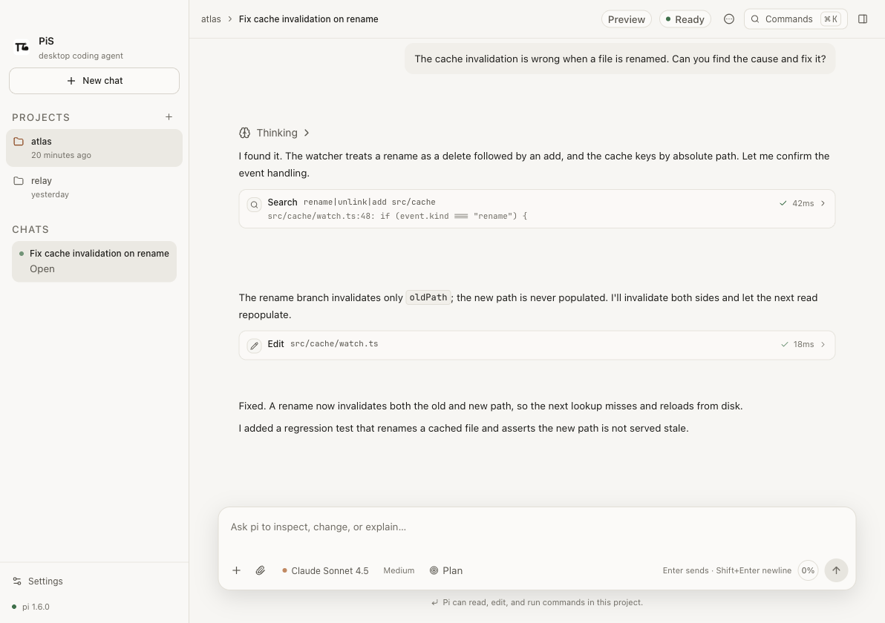
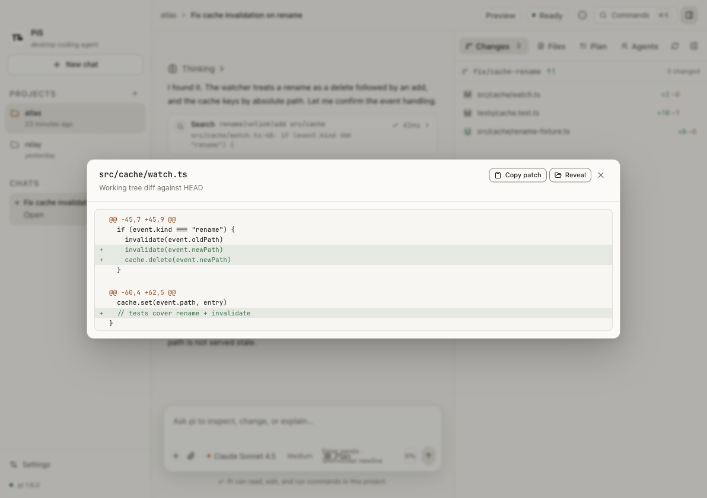

# UX and visual direction

[English](ux.md) | [简体中文](ux.zh.md)

PiS is a calm, fast, native-feeling coding agent. It is not an IDE and not a chat toy.



## Principles

1. The work is the interface. The transcript, tool activity, and changes dominate. Chrome recedes.
2. One primary action per state: send, stop, answer, approve, or choose.
3. State is legible without opening a menu: project, session, model, mode, run state, and pending input.
4. No surprise interruptions. Streaming does not steal scroll. Dialogs queue. Approvals stay pending. Background completions notify instead of stealing focus.
5. Fast is a feature. No spinner for a local operation. Skeletons only for real waits. Transitions under 200 ms. No layout jump while text streams.
6. Native where it counts: traffic lights, menus, shortcuts, notifications, file dialogs, Trash, and window restore. Web only where it buys richness.
7. State limits honestly. TUI-only extension UI, unsigned builds, untested platforms, and heuristics are documented.

## Layout

```text
┌───────────────┬──────────────────────────────────────────────┬───────────────┐
│ sidebar       │ top bar: project / session / run state        │ right panel   │
│  new chat     │                                              │  Changes      │
│  projects     │  transcript (centered column, max 860 px)     │  Files        │
│   sessions    │                                              │  Plan         │
│  settings     │                                              │  Agents       │
│               │  interaction dock (question/approval)         │               │
│               │  composer (model, mode, context, send)        │               │
└───────────────┴──────────────────────────────────────────────┴───────────────┘
```

- Sidebar: 280 px default, 220–480 px, collapsible.
- Right panel: 360 px default, 280–720 px, collapsible. Changes first, then Files.
- Chat column: max 860 px. Code and diff can use the full column.
- Empty home: product mark, open project, new chat, recent projects, and three concrete starters. No marketing copy.
- Composer sits at the bottom on a subtle surface. It is not a large card.
- Narrow windows: the right panel becomes a sheet; the sidebar overlays.

## Visual system

Type:

- System UI font on macOS; monospace for code.
- Body 13.5–14 px; Markdown 13.5 px with 1.72 line height; code 12–14 px; labels 9–11.5 px.
- Compact, but every label remains readable at 100% scale.
- Settings can change code font size and interface scale.

Color:

- Warm neutral surfaces. One amber/orange accent. Semantic green, red, and yellow.
- Light and dark are tuned separately, not inverted.
- No purple gradients and no glass everywhere.
- Layered neutrals with 1 px borders. Shadows only on floating layers.
- Tool cards use a quieter surface than messages. Secondary text is subtle; tertiary text is faint.

Density:

- Comfortable, not airy. Tool rows are compact and expand on demand.
- Code blocks and diffs use a separate font-size variable.

Motion:

- 120–180 ms ease-out for panels and popovers.
- A blinking cursor while text streams. No bouncing.
- Respect `prefers-reduced-motion`.

Icons:

- Lucide. 16 px in rows, 18 px in toolbars. No emoji as UI icons.

## Components

- Base UI primitives with the shadcn-style component surface.
- Product surfaces stay bespoke: tool cards, diff view, approval dock, extension status rail, changes panel.
- Markdown uses Streamdown with code, math, CJK, and Mermaid plugins. The plugins own loading and errors; app CSS only aligns container tokens.
- Prompt, approval, and settings dialogs share one visual language.
- Right panel tabs: Changes, Files, Plan, Agents. Plan is a quiet checklist with completed items struck through and the active item marked "now". It reads pi todo state.
- MCP and worktree managers are dialogs, not new top-level pages. They show source (`user` / `project`) and put destructive actions behind confirmation.
- Per-file revert is a hover action with a danger confirmation. It is never the default action.

## Transcript

- Messages use a readable column. User messages are muted bubbles; assistant messages are open text.
- Tool calls appear as compact cards. Expand for output, diff, images, and arguments.
- Thinking blocks are collapsed; the reader opens them on demand.
- Compaction and branch summaries appear as separators, not messages.
- The scroll position is respected. New tokens do not pull a reader who scrolled up. A "scroll to latest" button appears when needed.
- Long sessions use TanStack Virtual. Rows measure themselves.



## Composer

- The composer shows the model, thinking level, plan mode, context usage, and send/stop action.
- Attachments and file suggestions appear above the input, not in a separate page.
- The send key follows the setting: Enter sends, or Enter adds a line and `⌘Enter` sends.
- Failed sends restore the draft and attachments.

## Interaction dock

- Approval and extension dialogs appear above the composer. They do not cover the transcript.
- The dock shows one request at a time. The rest queue.
- A request shows the tool, command or path, risk reason, and options.
- A timeout dismisses the dock; pi resolves the request on its side.

## Status and notifications

- Extension statuses appear above the composer. PiS caps them at six and strips ANSI.
- Widgets are off by default.
- Background completion sends a system notification only when PiS is not in the foreground.
- Toasts report short successes and errors. They do not replace an error banner in the session.

## Empty and error states

- The empty page explains what PiS is and offers three concrete starts.
- A missing pi shows a banner with Locate pi and Install guide.
- No model shows a banner with Connect.
- A session error shows a dismissible banner with the message.
- An exited session stays visible with its last content.

## Keyboard

- `⌘K` command palette.
- `⌘N`, `⌘O`, `⌘W`, `⌘,`.
- `⌘B` sidebar, `⌘⇧G` right panel.
- `⌘⇧T` session tree, `⌘⇧C` compact, `⌘⇧M` model.
- `Esc` stops a run when no dialog is open.

The full list is in the [user guide](https://pis.modyqyw.top/guide/shortcuts).

## Tone

- Plain and factual. No hype and no exclamation marks.
- Say what happened and what to do next.
- State limits. Do not hide an unsupported TUI feature or an unsigned build.

## Related

- [Feature implementation](features.md)
- [Research](research.md)
- [Testing](testing.md)
