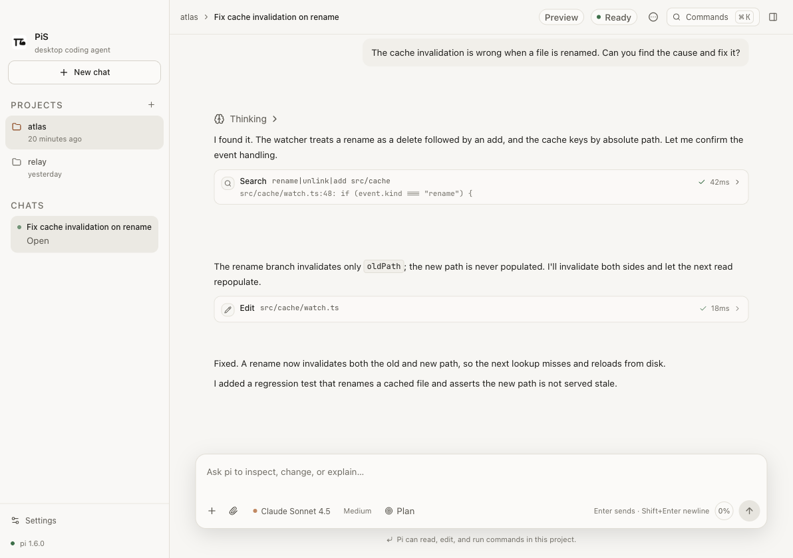
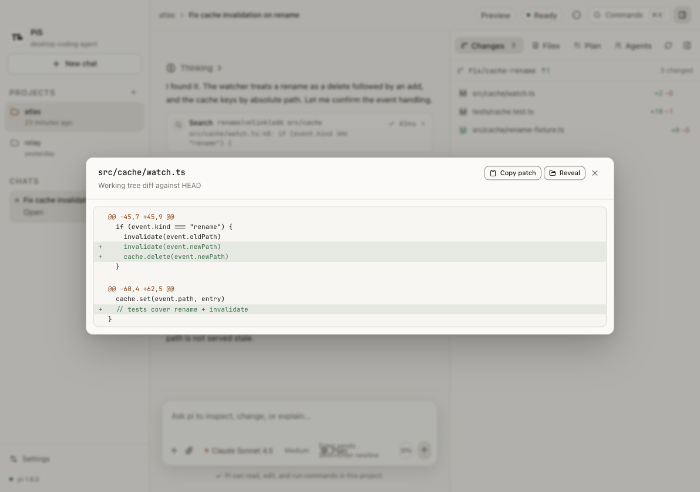

# UX 与视觉方向

[English](ux.md) | 简体中文

PiS 是安静、快速、原生感的 Coding Agent。它不是 IDE，也不是聊天玩具。



## 原则

1. 工作是界面。会话记录、工具活动和更改占主导，外壳后退。
2. 每个状态只有一个主操作：发送、停止、回答、批准或选择。
3. 不打开菜单也能看懂状态：项目、会话、模型、模式、运行状态和待输入。
4. 不打断读者。流式输出不抢滚动位置。对话框排队。审批保持等待。后台完成用通知，不抢焦点。
5. 快是功能。本地操作不显示转圈。只在真实等待时显示骨架。过渡少于 200 ms。文本流式输出时不跳布局。
6. 该原生的地方保持原生：红绿灯、菜单、快捷键、通知、文件对话框、废纸篓和窗口恢复。Web 只用在能带来丰富度的地方。
7. 如实说明限制。TUI 专属扩展 UI、未签名构建、未验证平台和启发式规则都写进文档。

## 布局

```text
┌───────────────┬──────────────────────────────────────────────┬───────────────┐
│ 侧边栏         │ 顶栏：项目 / 会话 / 运行状态                   │ 右侧面板       │
│  新对话        │                                              │  更改          │
│  项目          │  会话记录（居中列，最大 860 px）               │  文件          │
│   会话         │                                              │  计划          │
│  设置          │                                              │  代理          │
│               │  交互坞（问题/审批）                           │               │
│               │  输入框（模型、模式、上下文、发送）             │               │
└───────────────┴──────────────────────────────────────────────┴───────────────┘
```

- 侧边栏默认 280 px，范围 220–480 px，可收起。
- 右侧面板默认 360 px，范围 280–720 px，可收起。先显示更改，再显示文件。
- 会话列最大 860 px。代码和 diff 可以使用整列。
- 空首页：产品标记、打开项目、新对话、最近项目，以及三个具体起点。没有营销文案。
- 输入框在底部，使用轻微的表面。它不是大卡片。
- 窄窗口：右侧面板变成 sheet；侧边栏覆盖内容。

## 视觉系统

字体：

- macOS 使用系统 UI 字体；代码使用等宽字体。
- 正文 13.5–14 px；Markdown 13.5 px，行高 1.72；代码 12–14 px；标签 9–11.5 px。
- 紧凑，但 100% 缩放下每个标签都能读。
- 设置可以修改代码字号和界面缩放。

颜色：

- 暖中性表面。一个琥珀/橙色强调色。语义绿色、红色和黄色。
- 明暗主题分别调整，不做简单反色。
- 不用紫色渐变，不把所有表面做成玻璃。
- 分层中性色和 1 px 边框。阴影只用于浮层。
- 工具卡片比消息更安静。次要文字用 subtle，三级文字用 faint。

密度：

- 舒适，不空旷。工具行默认紧凑，按需展开。
- 代码块和 diff 使用单独的字号变量。

动效：

- 面板和弹层使用 120–180 ms ease-out。
- 流式文本显示闪烁光标。不弹跳。
- 遵守 `prefers-reduced-motion`。

图标：

- Lucide。行内 16 px，工具栏 18 px。不用 emoji 当 UI 图标。

## 组件

- Base UI 原语，配 shadcn 风格组件表面。
- 产品专用表面保持定制：工具卡片、diff、审批坞、扩展状态栏、更改面板。
- Markdown 使用 Streamdown 的 code、math、CJK 和 Mermaid 插件。加载和错误由插件负责；应用 CSS 只对齐容器 token。
- 输入、审批和设置对话框共用一套视觉语言。
- 右侧面板标签：更改、文件、计划、代理。计划是安静的清单，完成项划线，当前项标「当前」。数据来自 pi 的 todo 状态。
- MCP 和工作树管理器是对话框，不是新的顶层页面。它们显示来源（`user` / `project`），危险操作放在确认后。
- 逐文件还原是悬停操作，需要危险确认。它不得成为默认操作。

## 会话记录

- 消息使用可读列。用户消息是柔和的泡泡；助手消息是开放文本。
- 工具调用显示为紧凑卡片。展开后看输出、diff、图片和参数。
- 思考块默认折叠，按需打开。
- 压缩和分支摘要显示为分隔行，不是消息。
- 尊重滚动位置。读者向上滚动后，新 token 不拉回底部。需要时显示「滚动到最新」按钮。
- 长会话使用 TanStack Virtual。行高自动测量。



## 输入框

- 输入框显示模型、思考级别、计划模式、上下文用量和发送/停止操作。
- 附件和文件建议显示在输入框上方，不跳到单独页面。
- 发送键跟随设置：Enter 发送，或 Enter 换行、`⌘Enter` 发送。
- 发送失败时恢复草稿和附件。

## 交互坞

- 审批和扩展对话框显示在输入框上方，不遮挡会话记录。
- 一次显示一个请求，其余排队。
- 请求显示工具、命令或路径、风险原因和选项。
- 超时后对话框消失；pi 在自身一侧解决请求。

## 状态和通知

- 扩展状态显示在输入框上方。PiS 最多显示 6 条，并去掉 ANSI。
- widget 默认关闭。
- 后台完成只在 PiS 不在前台时发送系统通知。
- toast 报告简短成功和错误。它不替代会话中的错误横幅。

## 空状态和错误状态

- 空页面说明 PiS 是什么，并给出三个具体起点。
- 找不到 pi 时显示横幅，带「定位 pi」和「安装指南」。
- 没有模型时显示横幅，带「连接」。
- 会话错误显示可关闭的横幅和错误消息。
- 已退出的会话保持可见，并保留最后内容。

## 键盘

- `⌘K` 命令面板。
- `⌘N`、`⌘O`、`⌘W`、`⌘,`。
- `⌘B` 侧边栏，`⌘⇧G` 右侧面板。
- `⌘⇧T` 会话树，`⌘⇧C` 压缩，`⌘⇧M` 模型。
- 没有对话框时，`Esc` 停止运行。

完整列表见[用户指南](https://pis.modyqyw.top/zh/guide/shortcuts)。

## 语气

- 平实、事实性。不要夸张，不用感叹号。
- 说明发生了什么，以及下一步做什么。
- 说明限制。不要隐藏不支持的 TUI 功能或未签名构建。

## 相关

- [功能实现](features.zh.md)
- [调研](research.zh.md)
- [测试](testing.zh.md)
